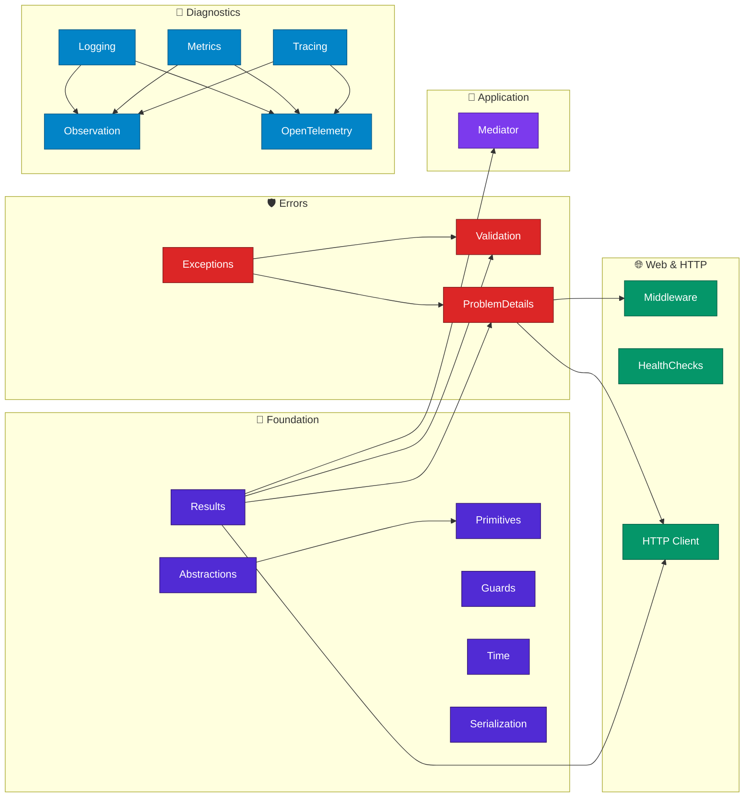

<div align="center">


# ✨ Atya Libraries

### Focused, composable, production-minded building blocks for modern .NET

Atya Libraries is a growing ecosystem of **.NET 10** libraries, developer tools, templates, and shared engineering infrastructure published under the **`Atya.*`** package prefix.

[](https://atyalibraries.github.io/)
[](https://www.nuget.org/packages?q=Atya.)
[](https://dotnet.microsoft.com/)
[](https://github.com/orgs/AtyaLibraries/repositories)
[](https://github.com/orgs/AtyaLibraries/projects/3)

<br />

[**Explore packages**](#-package-catalog) ·
[**Choose a package**](#-choose-the-right-package) ·
[**View the architecture**](#-ecosystem-map) ·
[**Start a repository**](#-developer-tooling-and-templates) ·
[**Contribute**](#-contributing)

</div>

---

## 🌌 What is Atya?

Atya Libraries provides small, explicit packages that can be adopted independently or composed into a consistent application platform.

The ecosystem is designed around a few principles:

* **Focused packages** — each repository owns a narrow, understandable responsibility.
* **Provider-neutral foundations** — core contracts avoid unnecessary framework and vendor coupling.
* **Explicit outcomes** — expected failures can be represented with `Result` and `Error` values instead of exception-driven control flow.
* **Clear boundaries** — application, diagnostics, HTTP, web, validation, and build concerns remain separate.
* **Production-minded defaults** — deterministic builds, package validation, dependency auditing, SourceLink, symbols, and automated release workflows.
* **Consistent developer experience** — shared build policy, analyzers, tests, templates, CI workflows, dependency updates, and release checks.

> [!TIP]
> You do not need to adopt the entire ecosystem. Start with one package, keep the dependency surface small, and add companion packages only where their boundary is useful.

---

## 🚀 Quick start

### Add a library

```bash
dotnet add package Atya.Foundation.Results
```

### Add ASP.NET Core error-boundary support

```bash
dotnet add package Atya.Web.Middleware
```

### Configure Atya diagnostics with OpenTelemetry

```bash
dotnet add package Atya.Diagnostics.OpenTelemetry
```

### Install the repository diagnostics tool

```bash
dotnet tool install --global Atya.Tooling.Cli
atya doctor
```

### Create a new package repository

```bash
dotnet new install Atya.Templates.NuGetPackage
dotnet new atya-nuget --name Foundation.Caching --output Atya.Foundation.Caching
```

Browse all published packages on [NuGet](https://www.nuget.org/packages?q=Atya.) or use the [Atya package catalog](https://atyalibraries.github.io/).

---

## 🧭 Ecosystem map

The following diagram shows the **conceptual composition** of the main package families. Arrows represent an integration or common composition path, not a requirement to install every connected package.



---

## 🎯 Choose the right package

| Need                                                                                      | Start with                                                                                                                                                          | Why                                                                                              |
| ----------------------------------------------------------------------------------------- | ------------------------------------------------------------------------------------------------------------------------------------------------------------------- | ------------------------------------------------------------------------------------------------ |
| Stable contracts for IDs, entities, auditing, soft deletion, paging, or result-like types | [`Atya.Foundation.Abstractions`](https://github.com/AtyaLibraries/Abstractions)                                                                                     | Provider-neutral interfaces with no implementation policy.                                       |
| Value objects, strongly typed IDs, paging models, and broader low-level primitives        | [`Atya.Foundation.Primitives`](https://github.com/AtyaLibraries/Primitives)                                                                                         | Reusable foundational types built above the contracts layer.                                     |
| A focused model for expected success and failure outcomes                                 | [`Atya.Foundation.Results`](https://github.com/AtyaLibraries/Results)                                                                                               | Small `Result`, `Result<T>`, `Error`, and error-kind model.                                      |
| Fast argument and invariant validation                                                    | [`Atya.Foundation.Guards`](https://github.com/AtyaLibraries/Guards)                                                                                                 | Lightweight guard clauses using standard .NET exceptions.                                        |
| Framework-neutral validation composition                                                  | [`Atya.Errors.Validation`](https://github.com/AtyaLibraries/Validation)                                                                                             | Validator contracts, failures, composition, and Results/exception integration.                   |
| Consistent reusable exception categories                                                  | [`Atya.Errors.Exceptions`](https://github.com/AtyaLibraries/Exceptions)                                                                                             | A focused taxonomy for domain, authorization, conflict, infrastructure, and validation failures. |
| RFC-style HTTP error responses                                                            | [`Atya.Errors.ProblemDetails`](https://github.com/AtyaLibraries/ProblemDetails)                                                                                     | Maps Atya exceptions and Results into ASP.NET Core ProblemDetails.                               |
| ASP.NET Core pipeline and endpoint adapters                                               | [`Atya.Web.Middleware`](https://github.com/AtyaLibraries/Middleware)                                                                                                | Connects Results, exceptions, and ProblemDetails at the HTTP boundary.                           |
| Reflection-free request/handler dispatch                                                  | [`Atya.Application.Mediator`](https://github.com/AtyaLibraries/Mediator)                                                                                            | Source-generated mediator registration and Result-returning handlers.                            |
| ProblemDetails-aware outbound HTTP calls                                                  | [`Atya.Http.Client`](https://github.com/AtyaLibraries/Client)                                                                                                       | Result-returning `HttpClient` helpers with correlation propagation.                              |
| Liveness and readiness endpoints                                                          | [`Atya.Web.HealthChecks`](https://github.com/AtyaLibraries/HealthChecks)                                                                                            | Opinionated ASP.NET Core health-check registration and JSON responses.                           |
| Logging, metrics, and tracing primitives                                                  | [`Logging`](https://github.com/AtyaLibraries/Logging), [`Metrics`](https://github.com/AtyaLibraries/Metrics), [`Tracing`](https://github.com/AtyaLibraries/Tracing) | Provider-neutral diagnostics based on standard .NET diagnostics APIs.                            |
| Host-level telemetry setup and OTLP export                                                | [`Atya.Diagnostics.OpenTelemetry`](https://github.com/AtyaLibraries/OpenTelemetry)                                                                                  | OpenTelemetry SDK registration, resource metadata, instrumentation, and exporter configuration.  |
| Test-only fakes and assertions                                                            | [`Atya.Governance.Testing`](https://github.com/AtyaLibraries/Testing)                                                                                               | Reusable test helpers without adding production dependencies.                                    |

---

# 📦 Package catalog

## 🧱 Foundation

| Package                                                                                                                                                                                                     | Repository                                                      | Purpose                                                                                                |
| ----------------------------------------------------------------------------------------------------------------------------------------------------------------------------------------------------------- | --------------------------------------------------------------- | ------------------------------------------------------------------------------------------------------ |
| [](https://www.nuget.org/packages/Atya.Foundation.Abstractions)    | [Abstractions](https://github.com/AtyaLibraries/Abstractions)   | Provider-neutral contracts for IDs, entities, auditing, soft deletion, paging, and result-like models. |
| [](https://www.nuget.org/packages/Atya.Foundation.Primitives)          | [Primitives](https://github.com/AtyaLibraries/Primitives)       | Low-level primitives including errors, results, value objects, strongly typed IDs, and paging models.  |
| [](https://www.nuget.org/packages/Atya.Foundation.Guards)                      | [Guards](https://github.com/AtyaLibraries/Guards)               | Lightweight guard clauses for arguments and low-level invariants.                                      |
| [](https://www.nuget.org/packages/Atya.Foundation.Time)                            | [Time](https://github.com/AtyaLibraries/Time)                   | UTC-safe clock abstractions and UTC input validation.                                                  |
| [](https://www.nuget.org/packages/Atya.Foundation.Serialization) | [Serialization](https://github.com/AtyaLibraries/Serialization) | Shared `System.Text.Json` defaults and configuration helpers.                                          |
| [](https://www.nuget.org/packages/Atya.Foundation.Results)                   | [Results](https://github.com/AtyaLibraries/Results)             | Focused Result and Error primitives for expected, recoverable outcomes.                                |

## 🛡️ Errors and application flow

| Package                                                                                                                                                                                            | Repository                                                        | Purpose                                                                                  |
| -------------------------------------------------------------------------------------------------------------------------------------------------------------------------------------------------- | ----------------------------------------------------------------- | ---------------------------------------------------------------------------------------- |
| [](https://www.nuget.org/packages/Atya.Errors.Exceptions)             | [Exceptions](https://github.com/AtyaLibraries/Exceptions)         | Reusable exception taxonomy without HTTP or transport coupling.                          |
| [](https://www.nuget.org/packages/Atya.Errors.Validation)             | [Validation](https://github.com/AtyaLibraries/Validation)         | Validation contracts, models, composition, and conversion to Atya Results or exceptions. |
| [](https://www.nuget.org/packages/Atya.Errors.ProblemDetails) | [ProblemDetails](https://github.com/AtyaLibraries/ProblemDetails) | ASP.NET Core ProblemDetails responses and exception/Result mapping at the HTTP boundary. |
| [](https://www.nuget.org/packages/Atya.Application.Mediator)    | [Mediator](https://github.com/AtyaLibraries/Mediator)             | Source-generated, reflection-free mediator contracts and Result-first dispatch.          |

## 📡 Diagnostics and observability

| Package                                                                                                                                                                                                        | Repository                                                      | Purpose                                                                                          |
| -------------------------------------------------------------------------------------------------------------------------------------------------------------------------------------------------------------- | --------------------------------------------------------------- | ------------------------------------------------------------------------------------------------ |
| [](https://www.nuget.org/packages/Atya.Diagnostics.Logging)                   | [Logging](https://github.com/AtyaLibraries/Logging)             | Provider-agnostic structured logging helpers.                                                    |
| [](https://www.nuget.org/packages/Atya.Diagnostics.Metrics)                   | [Metrics](https://github.com/AtyaLibraries/Metrics)             | Metrics helpers built on `System.Diagnostics.Metrics`.                                           |
| [](https://www.nuget.org/packages/Atya.Diagnostics.Tracing)                   | [Tracing](https://github.com/AtyaLibraries/Tracing)             | Tracing helpers built on `System.Diagnostics.Activity`.                                          |
| [](https://www.nuget.org/packages/Atya.Diagnostics.Observation)       | [Observation](https://github.com/AtyaLibraries/Observation)     | Thin composition over Atya logging, metrics, and tracing.                                        |
| [](https://www.nuget.org/packages/Atya.Diagnostics.OpenTelemetry) | [OpenTelemetry](https://github.com/AtyaLibraries/OpenTelemetry) | Host-facing OpenTelemetry SDK setup, resource metadata, instrumentation, and OTLP configuration. |

## 🌐 Web and HTTP

| Package                                                                                                                                                                             | Repository                                                    | Purpose                                                                                       |
| ----------------------------------------------------------------------------------------------------------------------------------------------------------------------------------- | ------------------------------------------------------------- | --------------------------------------------------------------------------------------------- |
| [](https://www.nuget.org/packages/Atya.Web.Middleware)       | [Middleware](https://github.com/AtyaLibraries/Middleware)     | ASP.NET Core adapters for Atya exceptions, Results, and ProblemDetails.                       |
| [](https://www.nuget.org/packages/Atya.Web.HealthChecks) | [HealthChecks](https://github.com/AtyaLibraries/HealthChecks) | Standard health, liveness, and readiness endpoint helpers.                                    |
| [](https://www.nuget.org/packages/Atya.Http.Client)                | [Client](https://github.com/AtyaLibraries/Client)             | Typed `HttpClient` helpers with Results, ProblemDetails mapping, and correlation propagation. |

## 🧪 Governance, build, and tooling

| Package                                                                                                                                                                                               | Repository                                                        | Purpose                                                                                                |
| ----------------------------------------------------------------------------------------------------------------------------------------------------------------------------------------------------- | ----------------------------------------------------------------- | ------------------------------------------------------------------------------------------------------ |
| [](https://www.nuget.org/packages/Atya.Governance.Testing)             | [Testing](https://github.com/AtyaLibraries/Testing)               | Test-only clocks, correlation/user fakes, JSON assertions, Result assertions, and validation builders. |
| [](https://www.nuget.org/packages/Atya.Governance.CodeQuality) | [CodeQuality](https://github.com/AtyaLibraries/CodeQuality)       | Centralized analyzers, StyleCop rules, and C# code-style policy through `buildTransitive`.             |
| [](https://www.nuget.org/packages/Atya.Build.Sdk)                                        | [Atya.Build.Sdk](https://github.com/AtyaLibraries/Atya.Build.Sdk) | Shared build, packaging, SourceLink, MinVer, naming, test, and NuGet metadata defaults.                |
| [](https://www.nuget.org/packages/Atya.Tooling.Cli)                                  | [Cli](https://github.com/AtyaLibraries/Cli)                       | Read-only repository conformance, release preflight, and post-release verification commands.           |

## 🧰 Templates

| Package                                                                                                                                                                                               | Repository                                                                             | Purpose                                                                                                            |
| ----------------------------------------------------------------------------------------------------------------------------------------------------------------------------------------------------- | -------------------------------------------------------------------------------------- | ------------------------------------------------------------------------------------------------------------------ |
| [](https://www.nuget.org/packages/Atya.Templates.NuGetPackage) | [NuGet package template](https://github.com/AtyaLibraries/Atya.Templates.NuGetPackage) | Production-ready .NET package repository template with tests, samples, benchmarks, CI, and publishing integration. |
| [](https://www.nuget.org/packages/Atya.Templates.UiAutomation) | [UI automation template](https://github.com/AtyaLibraries/Atya.Templates.UiAutomation) | .NET 10, Playwright, xUnit v3, and Microsoft Testing Platform solution template.                                   |

---

## 🛠️ Developer tooling and templates

Atya is more than a package catalog. The organization maintains a shared engineering platform that helps repositories behave consistently.

### Build SDK

`Atya.Build.Sdk` centralizes conditional defaults for:

* target framework and language settings;
* nullable reference types and implicit usings;
* deterministic builds and warnings-as-errors;
* NuGet auditing and lock files;
* package naming and metadata validation;
* SourceLink, symbols, documentation, and package validation;
* common test-project dependencies and configuration.

```json
{
  "msbuild-sdks": {
    "Atya.Build.Sdk": "<version>"
  }
}
```

```xml
<Project Sdk="Atya.Build.Sdk">
  <PropertyGroup>
    <PackageId>Atya.Foundation.Example</PackageId>
    <AssemblyName>Atya.Foundation.Example</AssemblyName>
    <RootNamespace>Atya.Foundation.Example</RootNamespace>
    <Description>Example Atya package.</Description>
    <Authors>AtyaLibraries</Authors>
    <RepositoryUrl>https://github.com/AtyaLibraries/Example</RepositoryUrl>
  </PropertyGroup>
</Project>
```

### Code-quality policy

`Atya.Governance.CodeQuality` distributes analyzer and StyleCop policy through a private build-only package reference:

```xml
<PackageReference
  Include="Atya.Governance.CodeQuality"
  Version="<version>"
  PrivateAssets="all" />
```

### Repository diagnostics

The `atya` CLI performs deterministic, read-only checks:

```bash
atya doctor
atya release check --online --version <version>
atya release verify --online --version <version>
```

The tool diagnoses repository and release state; it intentionally does not publish packages, create tags, rewrite repositories, or manage secrets.

### Templates

```bash
# NuGet package repository
dotnet new install Atya.Templates.NuGetPackage
dotnet new atya-nuget --name Foundation.Caching

# UI automation solution
dotnet new install Atya.Templates.UiAutomation
dotnet new atya-ui-automation --name Contoso.Shop.UiAutomation
```

---

## ⚙️ Platform and organization repositories

| Repository                                                                            | Responsibility                                                                                               |
| ------------------------------------------------------------------------------------- | ------------------------------------------------------------------------------------------------------------ |
| [`.github`](https://github.com/AtyaLibraries/.github)                                 | Organization profile and shared GitHub-facing metadata.                                                      |
| [`github-workflows`](https://github.com/AtyaLibraries/github-workflows)               | Reusable GitHub Actions workflows and composite actions for package CI, CodeQL, and dependency review.       |
| [`publisher`](https://github.com/AtyaLibraries/publisher)                             | Central package publishing path using NuGet trusted publishing and OIDC rather than per-repository API keys. |
| [`renovate-config`](https://github.com/AtyaLibraries/renovate-config)                 | Shared dependency-update policy, grouped NuGet updates, action digest pinning, and lock-file maintenance.    |
| [`AtyaLibraries.github.io`](https://github.com/AtyaLibraries/AtyaLibraries.github.io) | Vite and React source for the public Atya package catalog on GitHub Pages.                                   |

---

## 🔐 Build, quality, and release model

The exact gates are repository-specific, but the shared Atya platform is designed to support a consistent release baseline:

```text
restore in locked mode
        ↓
dependency vulnerability audit
        ↓
format and analyzer verification
        ↓
deterministic Release build
        ↓
unit tests and configured coverage gates
        ↓
NuGet package validation
        ↓
.nupkg + .snupkg artifacts
        ↓
protected central publishing through OIDC
        ↓
NuGet package + GitHub release
```

Common platform capabilities include:

* reusable CI workflows pinned by release tags;
* CodeQL and dependency-review workflows;
* deterministic builds with SourceLink and symbols;
* locked dependency graphs and vulnerability auditing;
* immutable SemVer package releases;
* centralized trusted publishing without repository-level NuGet API keys;
* Renovate-driven dependency and lock-file maintenance;
* package naming and metadata guards.

> [!IMPORTANT]
> Always follow the instructions in the target repository. Some repositories add specialized smoke tests, benchmarks, generated-code checks, public API tracking, or template validation.

---

## 🗂️ Repository conventions

A typical Atya package repository follows this shape:

```text
src/<Package>/                    shipped library or tool
tests/<Package>.UnitTests/        automated behavioral coverage
samples/<Package>.Samples.*/      runnable consumer examples
benchmarks/<Package>.Benchmarks/  BenchmarkDotNet harness
.github/workflows/                CI, security, and release entry points
README.md                         maintainer and contributor documentation
LICENSE                           package license
```

Common conventions:

* NuGet package IDs use the `Atya.{Area}.{Name}` family where applicable.
* Package, assembly, and root namespace identities are intentionally aligned.
* Packages target modern .NET and currently standardize on **.NET 10**.
* Public package APIs remain small and boundary-focused.
* Consumer documentation lives with the package and is included in NuGet packages where appropriate.
* Individual repositories are versioned and released independently.

---

## 🤝 Contributing

Contributions are welcome across the ecosystem.

1. Choose the repository that owns the behavior or package boundary.
2. Read its README and repository-specific development instructions.
3. Keep changes focused and avoid introducing dependencies outside the package's responsibility.
4. Add or update tests, samples, documentation, and public API tracking where required.
5. Run the repository's restore, format, build, test, audit, and pack checks.
6. Open a clear pull request describing the problem, solution, compatibility impact, and validation performed.

For bugs and feature proposals, open an issue in the relevant repository so the discussion stays close to the code and release history.

---

## 🔗 Useful links

* 🌐 [Atya Libraries website and package catalog](https://atyalibraries.github.io/)
* 📦 [Search all `Atya.*` packages on NuGet](https://www.nuget.org/packages?q=Atya.)
* 👤 [NuGet publisher profile](https://www.nuget.org/profiles/ArsenAsulyan)
* 🗃️ [Browse organization repositories](https://github.com/orgs/AtyaLibraries/repositories)
* 🗺️ [Atya Platform project board](https://github.com/orgs/AtyaLibraries/projects/3)
* 🧰 [Create a package with the Atya template](https://github.com/AtyaLibraries/Atya.Templates.NuGetPackage)
* ✅ [Validate a repository with the Atya CLI](https://github.com/AtyaLibraries/Cli)

---

## 📄 License

Atya library repositories are released under the **MIT License** unless a repository explicitly states otherwise. See the `LICENSE` file in each repository for the authoritative terms.

---

<div align="center">

### Build small. Compose deliberately. Ship confidently.

Made with 💜 and .NET by **[Atya Libraries](https://github.com/AtyaLibraries)**.

</div>
